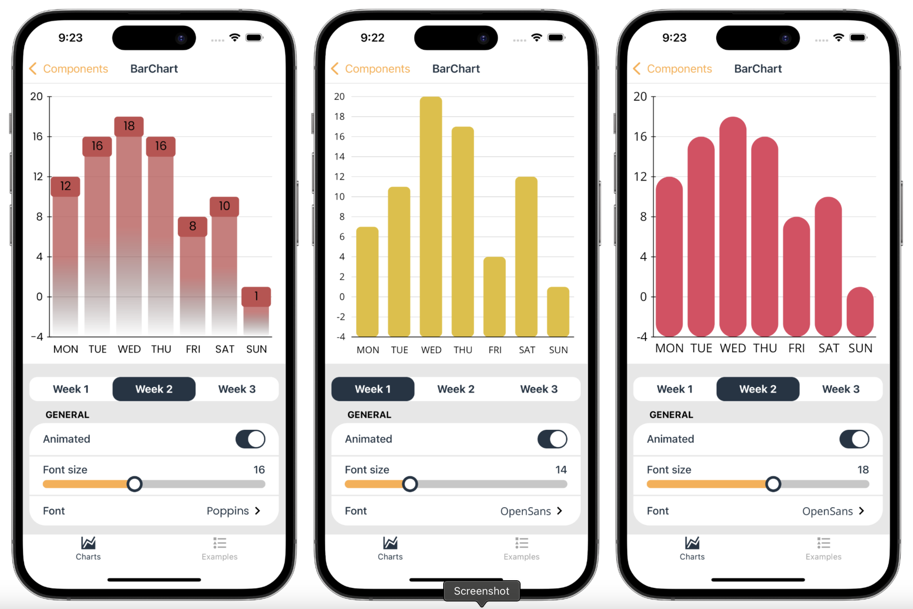
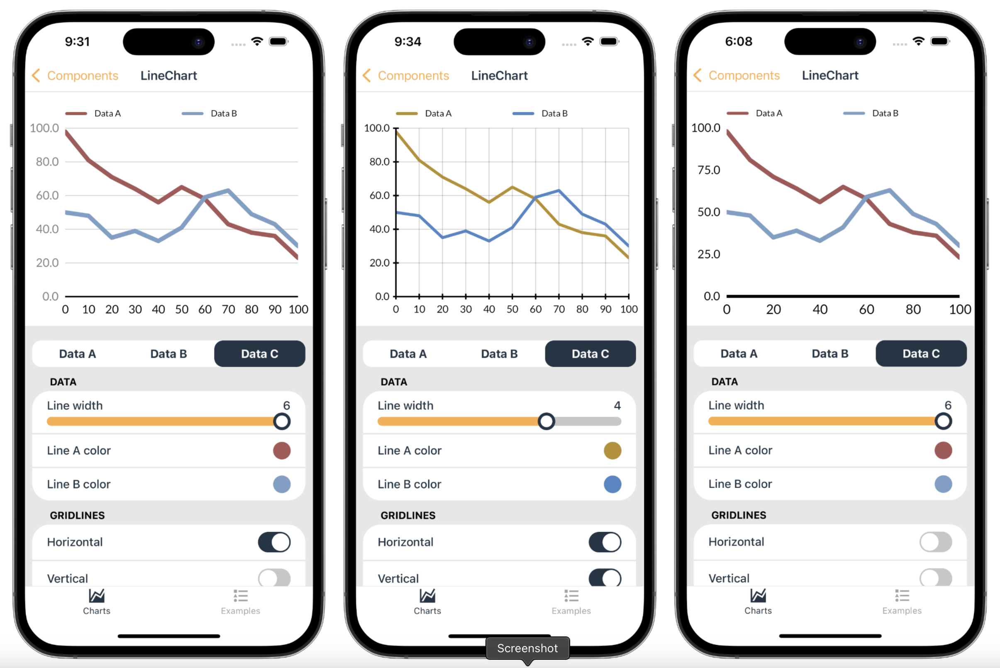
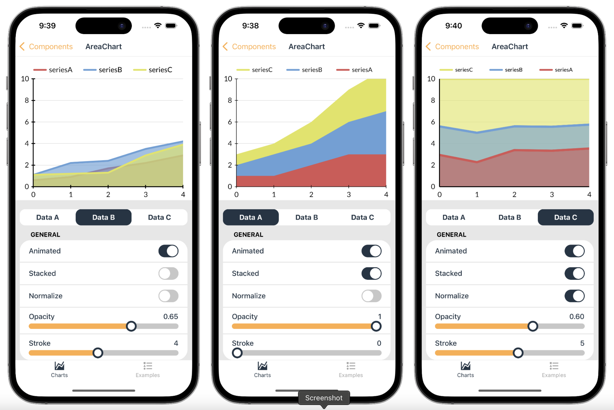
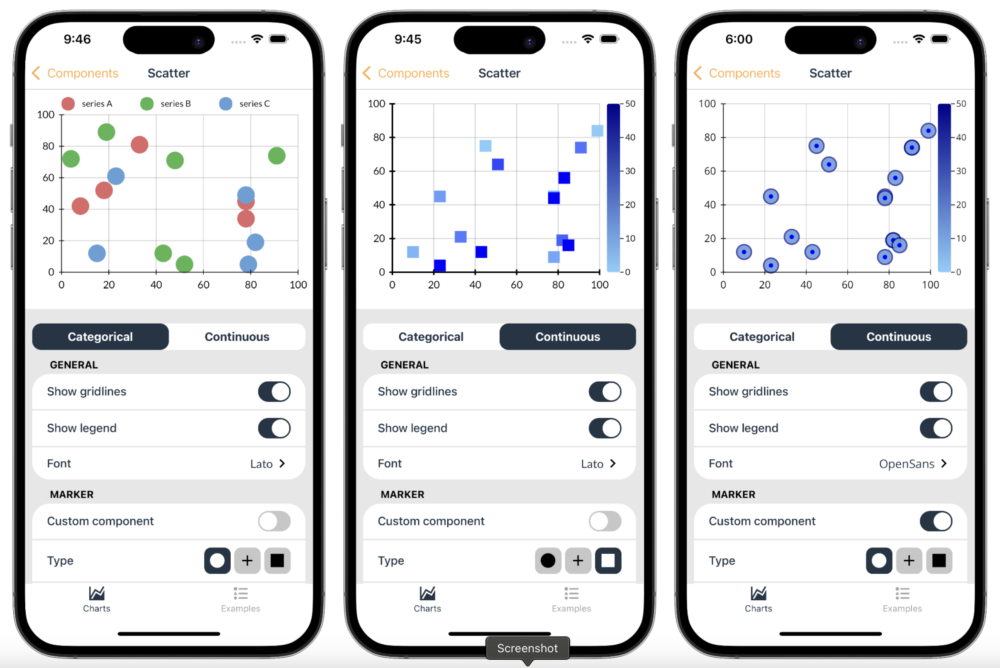
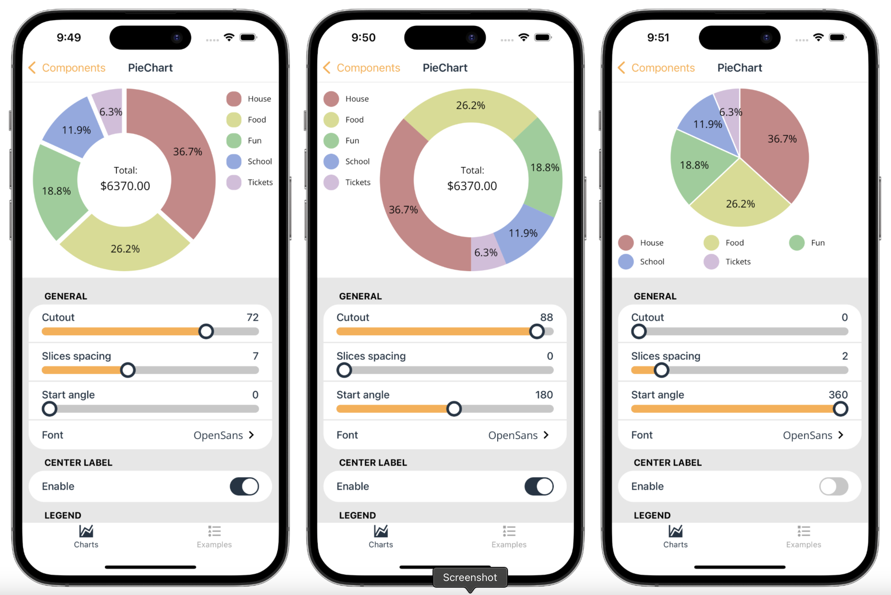
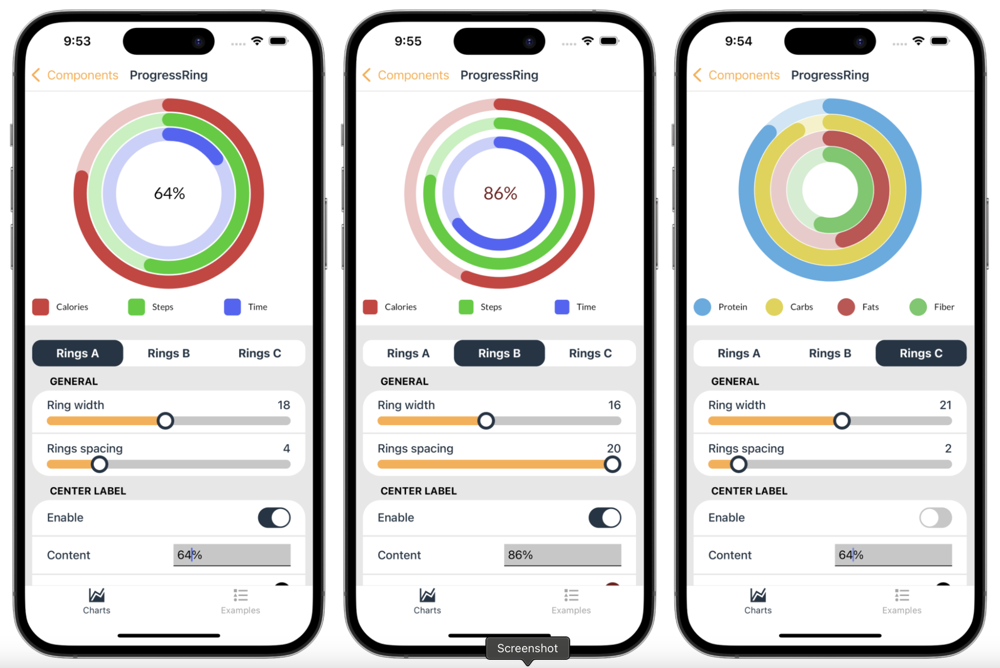
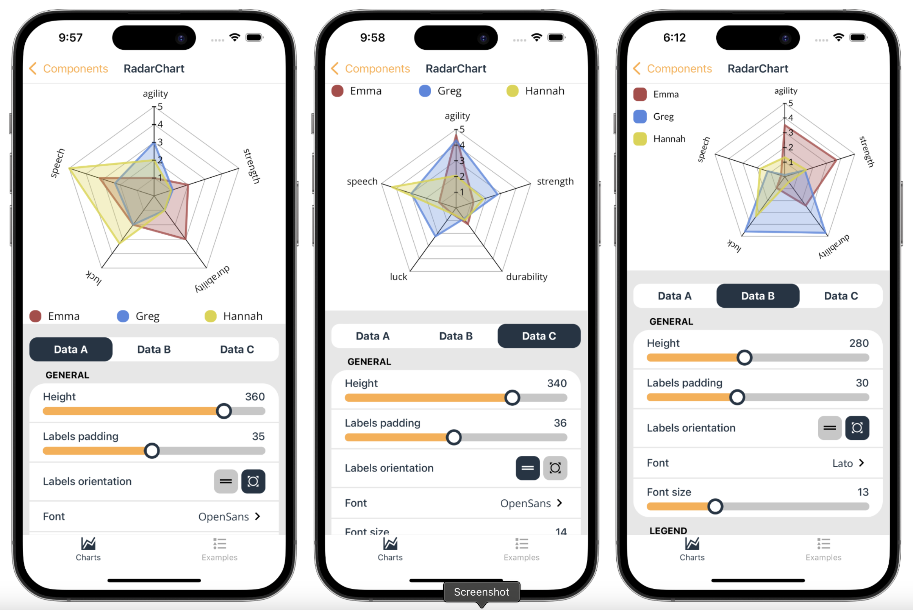

# react-native-visualized

Skia based library for creating delightful and high performance charts

## Installation

```sh
npm install react-native-visualized
```

## Examples

### Bar chart 


### Line chart 


### Area chart 


### Scatter


### Pie Chart


### Activity Rings


### Radar Chart


## License

MIT

---

Made with [create-react-native-library](https://github.com/callstack/react-native-builder-bob)
